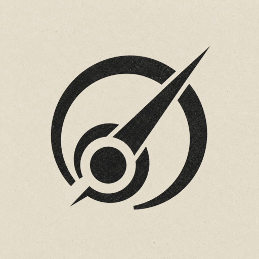

# RZK // THE HUNTER

**A parasitic investigation skill for AI agents.** 
Adaptive research · verified sources · traceable evidence

[Quick start](#quick-start) · [What you can investigate](#what-you-can-investigate) · [Working with evidence](#working-with-evidence) · [Project details](#project-details)

The Hunter is an open-source intelligence (OSINT) skill for AI agents. Give it a question, a claim or an image. It traces findings to public sources, checks competing explanations and tells you what the evidence leaves unresolved.

## Quick start

1. Download and extract the complete [release archive](https://github.com/shoyann/RZK-The-Hunter/releases/latest), or clone this repository.
2. Place the package in your agent’s skills directory as `awesome-osint-operator/`, with `SKILL.md` at its root. You can also point your agent directly at [SKILL.md](SKILL.md) in a full checkout.
3. From the package directory, run `python scripts/verify_package.py`. Then ask your agent a question.

> Use The Hunter to check whether this museum offered free admission in 2009. Cite a source from that period and flag any gaps in the record.

## What you can investigate

| Question | How The Hunter approaches it |
| --- | --- |
| Where did this claim originate? | Trace citations to the earliest available source and check whether later accounts provide independent evidence. [Fact-checking workflow](workflows/news-fact-check.md) |
| What connects these organizations? | Compare filings, ownership records and dates. [Organization workflow](workflows/company-org.md) |
| Does this photograph support its caption? | Compare visible details with reference images and check the date and viewpoint. [Visual evidence workflow](workflows/image-video-geolocation.md) |
| How has this domain changed? | Examine DNS records, certificates and archived pages. [Infrastructure workflow](workflows/domain-infrastructure.md) |

A narrow lookup can end with a citation and a short answer. For a longer investigation, the agent can keep a CSV evidence ledger or create a visual comparison with source credits. [Worked examples](examples/README.md) · [Visual evidence boards](references/visual-evidence-board.md)

## Working with evidence

The Hunter uses public or authorized material. Findings distinguish direct observations from inferences and identify conflicting sources. The safety policy covers personal data, defensive research and guarded official wanted/fugitive-person location intelligence. [Safety policy](references/safety-policy.md)

In OSINT challenge runs, the host model using The Hunter and its available tools reached **#1 on OSINT UK** and **#8 on OSINT Industries** within 48 hours. These rankings describe the combined setup. [Evaluation methods](references/trajectory-evaluation.md)

## Project details

Release: `v1.6.1` · [Changelog](CHANGELOG.md)

The tool catalog is adapted from [Awesome OSINT](https://github.com/jivoi/awesome-osint). The attribution file records the source snapshot date and SHA-256 digest. [Attribution](ATTRIBUTION.md) · [CC BY-SA 4.0 license](LICENSE.txt)
